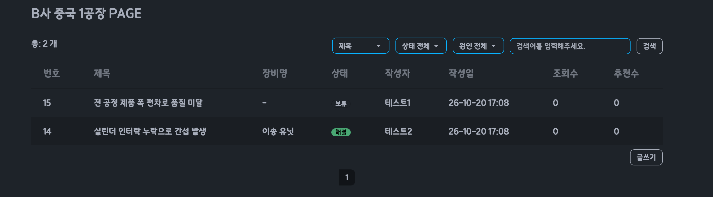
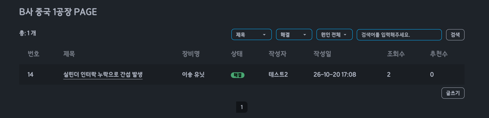
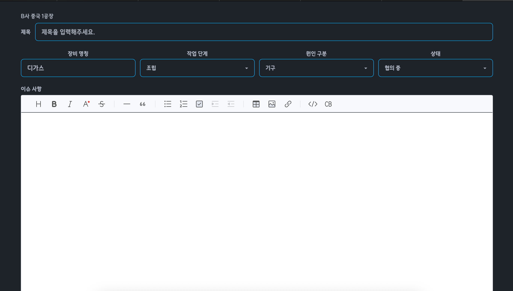
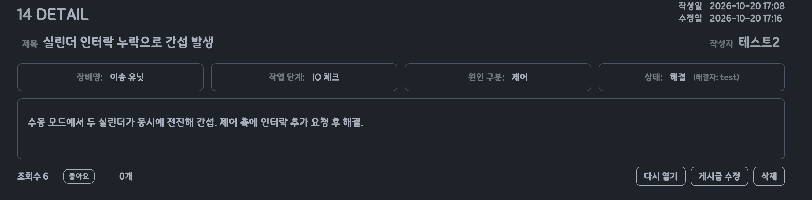
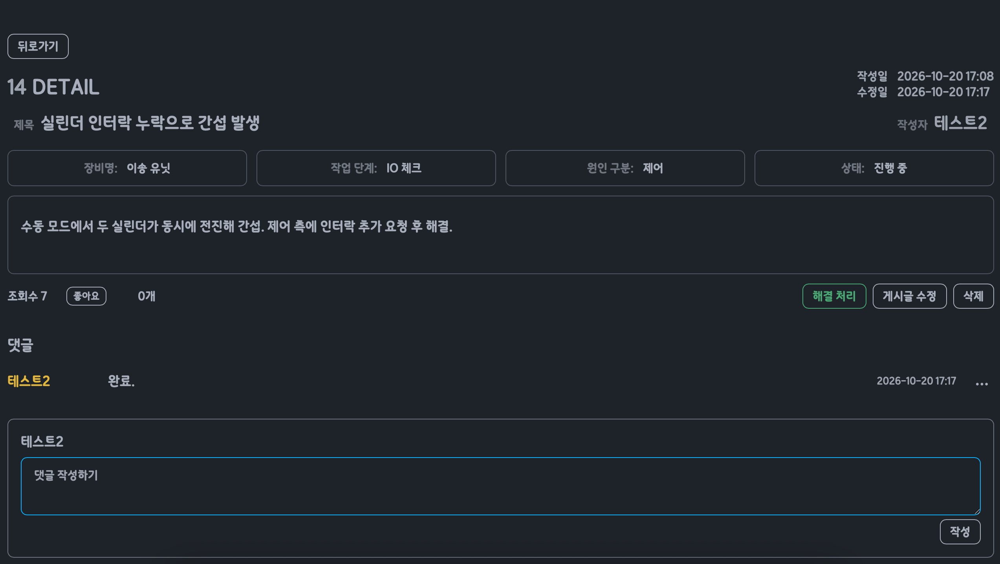

# 현장 이슈 기록 시스템

장비 셋업 현장에서 생기는 이슈를 현장별로 기록하고, 해결 여부와 해결한 사람까지 남기는 Spring Boot 웹 서비스입니다.

학원 과정에서 만든 게시판([기반 저장소](https://github.com/jeongo01/2026_08_STS4))을 바탕으로, 2차전지 장비 현장에서 일한 경험을 담아 확장했습니다.

 

## 만든 이유

- 장비 셋업 현장에서는 프로젝트 진행도나 그날 한 일을 수기로 관리하기도 하고 앱으로 관리하기도 합니다. 하지만 앱은 오류가 많았고, 복잡해 결국 잘 쓰지 않게 되는 것을 봤습니다. 그리고 여러 자료가 섞여 있어 필요한 것을 찾기 어려웠고, 있을 것 같은 곳에 들어가 보면 정작 없는 경우가 많았습니다.

그래서 다음 세 가지에 집중했습니다.

- **쉽게 남기기**: 작업 단계, 원인 유형, 상태는 직접 입력하지 않고 목록에서 고르기
- **쉽게 찾기**: 이슈를 현장별로 나누고, 상태와 원인으로 걸러 보기
- **이력 남기기**: 누가 해결했는지, 다시 열린 이슈인지 기록하기

 

## 주요 기능

### 현장별 이슈 목록
현장(게시판)마다 이슈를 따로 모으고, 상태를 색으로 구분합니다.

### 상태·원인 필터
상태(진행 중, 협의 중, 해결, 보류)와 원인 유형으로 이슈를 걸러 봅니다.

### 이슈 기록
장비명, 작업 단계, 원인 구분, 상태를 함께 기록합니다.

### 해결 처리와 다시 열기
로그인한 사용자는 이슈를 해결 처리할 수 있고, 해결한 사람이 함께 기록됩니다. 해결된 이슈는 다시 열 수 있습니다.

### 그 밖의 기능
- 회원가입, 로그인 (비밀번호 BCrypt 해시 저장)
- 댓글 작성, 수정, 삭제 (수정·삭제는 Ajax 비동기 처리)
- 추천(좋아요), 조회수
- 제목·이슈 사항 검색, 페이징

 

## 기술 스택

| 구분 | 내용 |
| --- | --- |
| Backend | Java, Spring Boot, MyBatis |
| DB | MySQL |
| Frontend | JSP, JSTL, JavaScript (jQuery, Ajax), Tailwind CSS, daisyUI |
| 도구 | Git, GitHub, Eclipse (STS) |

 

## 문제 해결 기록

### 1. 댓글 수정·삭제를 비동기로 바꾸며 생긴 문제
- **문제**: 댓글을 수정하거나 삭제할 때마다 페이지 전체가 새로고침되어 화면이 깜빡였습니다.

- **해결**: Ajax 요청으로 바꾸고, Controller는 처리 결과를 JSON으로 돌려주고 화면은 해당 댓글만 갱신하도록 나눴습니다.
- **그 과정에서 생긴 문제**
  - 수정 후에도 이전 내용이 보임 → 화면에서 갱신할 요소의 class 이름이 빠져 있어 추가
  - 로그인 상태인데 "로그아웃 후 이용해주세요" 응답 → 새 요청 경로를 로그인 필요 인터셉터가 아닌 곳에 등록해 둔 것을 수정
- **배운 점**: 화면과 서버가 주고받는 형식과 경로를 정확히 맞춰야 기능이 동작한다는 것

### 2. 게시글 삭제 후 남는 데이터
- **문제**: 게시글을 삭제해도 댓글과 추천 기록이 DB에 그대로 남았습니다.

- **해결**: 삭제 로직을 Service에 모아 댓글 → 추천 → 게시글 순서로 지우고, `@Transactional`을 적용해 중간에 하나라도 실패하면 전체가 취소되도록 했습니다.

### 3. 평문으로 저장되던 비밀번호
- **문제**: 회원 비밀번호가 DB에 그대로 저장되고 있었습니다.

- **해결**: `PasswordEncoder`(BCrypt)를 Bean으로 등록해 가입할 때 해시로 저장하고, 로그인할 때 `matches`로 비교하도록 바꿨습니다. 기존 회원 데이터도 해시로 옮겼습니다.
- DB 접속 정보가 담긴 `application.yml`은 Git에서 제외하고, 형식만 담은 예시 파일을 대신 올렸습니다.

### 4. 댓글에 입력한 HTML이 그대로 실행되는 문제 (XSS)
- **문제**: 댓글에 `<b>굵게</b>` 입력 시 태그는 사라지고 "굵게"라는 글자만 보였습니다. 브라우저가 `<b>`를 글자가 아니라 HTML태그로 처리한 것으로, `<script>` 를 넣으면 실행 될 수 있는 상태였던 것.

- **해결**: 댓글 출력 메서드에 사용자 입력을 먼저 HTML escape 처리하고, 그 다음 줄바꿈만 ` `로 바꾸도록 순서를 정한다. (이제 `<b>굵게</b>` 글자가 그대로 보인다.)

 

## 실행 방법

1. MySQL에서 `DB.txt`의 SQL을 실행합니다. (DB 생성, 테이블, 샘플 데이터)
2. `src/main/resources/application.yml.example`을 복사해 `application.yml`로 이름을 바꾸고, DB 비밀번호를 입력합니다.
3. 프로젝트를 실행한 뒤 `http://localhost:8081`로 접속합니다.
4. 테스트 계정: `test1` / `test1`

 

## 향후 개선

- 비밀번호 규칙 검사 (최소 길이, 영문·숫자·특수문자)
- 닉네임 중복 확인
- 장비명도 목록에서 선택해 같은 기준으로 기록
- 이슈별 주의사항 칸
- 회사별 현장 규칙(예: 배관 색 규칙)을 남기는 공간
- 큰 글씨와 단순한 화면 (현장 사용자 연령층 고려)

 

## 공부 기록

- 블로그: [blog.naver.com/wjddh1121](https://blog.naver.com/wjddh1121)
